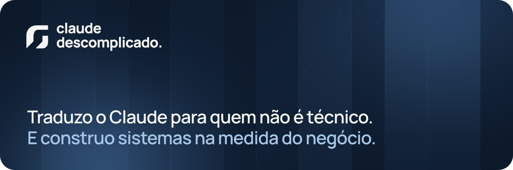
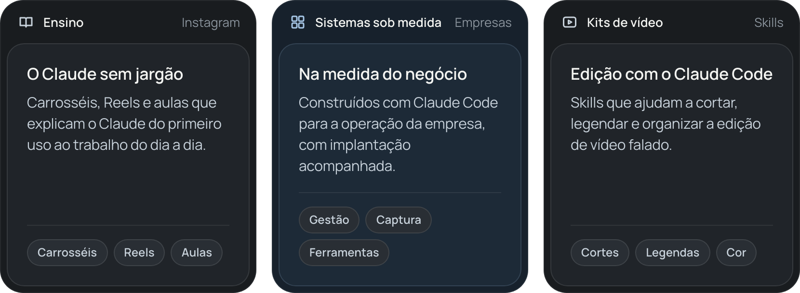

  

Sou o Junior. No **Claude Descomplicado** eu traduzo o Claude, da Anthropic, para quem não é técnico, em carrosséis, Reels e aulas. Fora do perfil, construo sistemas sob medida com Claude Code para empresas.

## O que eu faço

  

## Como eu trabalho

- **Mostro a conta.** Explico o que a ferramenta faz, o que ela não faz e como conferir o resultado.
- **Construo na medida.** *Built to suit*: o tamanho do sistema acompanha o problema, não o contrário.
- **Implanto junto.** A entrega é acompanhada, com quem vai usar e com critérios claros de uso.

## Repositório aberto

[**claude-skills**](https://github.com/AosJunior/claude-skills): skills de edição de vídeo para o Claude Code, escritas em Python.

## Ferramentas

## Onde me encontrar

- Site: [claudedescomplicado.com.br](https://claudedescomplicado.com.br)
- Instagram: [@claudedescomplicado](https://www.instagram.com/claudedescomplicado/)

 

  

Claude Descomplicado é um projeto independente, sem vínculo oficial com a Anthropic.

